# Phương Pháp Tiếp Cận Lai Trong Bảo Mật Dữ Liệu (Phiên Bản Python)

Ứng dụng desktop xây dựng bằng **Python**, được phát triển dựa trên ý tưởng của dự án nghiên cứu kỹ thuật nhằm khám phá phương pháp tiếp cận lai (hybrid approach) trong bảo mật và truyền dữ liệu bằng cách kết hợp: **Mã hóa AES, Nén không mất dữ liệu LZW, Kỹ thuật giấu tin trong ảnh LSB (Least Significant Bit), và quy trình trích xuất bảo vệ bằng khóa**.

Ứng dụng tích hợp nhiều kỹ thuật vào một quy trình hoàn chỉnh từ người gửi (Sender/Encoder) đến người nhận (Receiver/Decoder):

1. Mã hóa văn bản gốc bằng thuật toán **AES**
2. Nén dữ liệu đã mã hóa bằng thuật toán **LZW** để giảm dung lượng
3. Giấu dữ liệu đã nén vào ảnh sử dụng kỹ thuật **LSB (Least Significant Bit Steganography)**
4. Bảo vệ quy trình trích xuất và giải mã bằng khóa bí mật (**Secret Key**), hỗ trợ gửi khóa qua Email
5. Phía người nhận: Trích xuất bit ẩn từ ảnh, giải nén LZW và giải mã AES để phục hồi nguyên vẹn văn bản ban đầu

Dự án chứng minh cách mật mã học (cryptography), nén dữ liệu (compression) và kỹ thuật giấu tin (steganography) có thể phối hợp nhịp nhàng nhằm mang lại sự an toàn đa tầng thay vì chỉ phụ thuộc vào một kỹ thuật duy nhất.

---

## Tính Năng Nổi Bật

- **Mã hóa & Giải mã AES**: Bảo vệ dữ liệu với chuẩn mã hóa mạnh mẽ (sử dụng thư viện `pycryptodome`).
- **Nén & Giải nén LZW không suy hao (Lossless)**: Giảm kích thước khối dữ liệu mã hóa trước khi giấu vào ảnh, tiết kiệm tải trọng điểm ảnh.
- **Giấu tin LSB trên ảnh số**: Nhúng dòng bit vào các bit có trọng số thấp nhất của kênh màu (sử dụng `Pillow` và tăng tốc độ xử lý điểm ảnh với `NumPy`).
- **Bảo toàn chất lượng ảnh**: Lưu trữ kết quả ở định dạng ảnh lossless (PNG), mắt thường gần như không thể phân biệt ảnh gốc và ảnh sau khi giấu tin.
- **Chia sẻ khóa bảo mật qua Email**: Tích hợp gửi khóa giải mã tự động cho người nhận thông qua giao thức SMTP (Gmail).
- **Giao diện đồ họa (GUI) Tkinter hiện đại**: Trực quan, dễ sử dụng, chia rõ hai quy trình Mã hóa (Encode) và Giải mã (Decode).
- **Độc lập nền tảng**: Chạy mượt mà trên Windows, macOS và Linux chỉ với môi trường Python.

---

## Kiến Trúc Hệ Thống

Ứng dụng kết hợp mật mã học, nén dữ liệu và giấu tin thành một đường ống xử lý (pipeline) liền mạch.

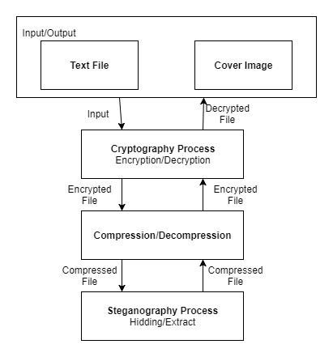

### Sơ Đồ Luồng Tổng Quan

```text
Văn bản gốc (Plain Text)
    │
    ▼
Mã hóa AES (AES Encryption)
    │
    ▼
Nén LZW (LZW Compression)
    │
    ▼
Giấu tin LSB vào ảnh (LSB Steganography)
    │
    ▼
Ảnh chứa dữ liệu giấu (Stego Image - PNG)
    │
    ▼
Truyền tải / Chia sẻ qua mạng hoặc tập tin
    │
    ▼
Trích xuất dòng bit LSB (LSB Extraction)
    │
    ▼
Giải nén LZW (LZW Decompression)
    │
    ▼
Giải mã AES (AES Decryption với Secret Key)
    │
    ▼
Văn bản gốc ban đầu (Original Text)
```

---

## Cách Thức Hoạt Động

### 1. Phía Người Gửi / Quy Trình Nhúng Dữ Liệu (Embedding Process)

Quy trình chuẩn bị và giấu thông điệp vào một bức ảnh vỏ bọc (cover image):

1. Nhập văn bản bí mật cần gửi.
2. Mã hóa chuỗi văn bản bằng thuật toán **AES-ECB** (với đệm PKCS7 và khóa bí mật).
3. Nén chuỗi ciphertext thu được bằng thuật toán **LZW**.
4. Chuyển đổi dữ liệu đã nén thành mảng byte, bổ sung 4 byte (32-bit header) ở đầu để lưu trữ chính xác kích thước dữ liệu.
5. Chuyển mảng byte thành dòng bit (bit stream).
6. Thay thế bit có trọng số thấp nhất (LSB) của từng giá trị màu pixel bằng bit dữ liệu cần giấu (tối ưu hóa qua mảng `NumPy`).
7. Xuất và lưu bức ảnh Stego dưới định dạng `.png` không nén mất dữ liệu.
8. *(Tùy chọn)* Gửi khóa bí mật trực tiếp tới hòm thư người nhận qua Gmail SMTP.

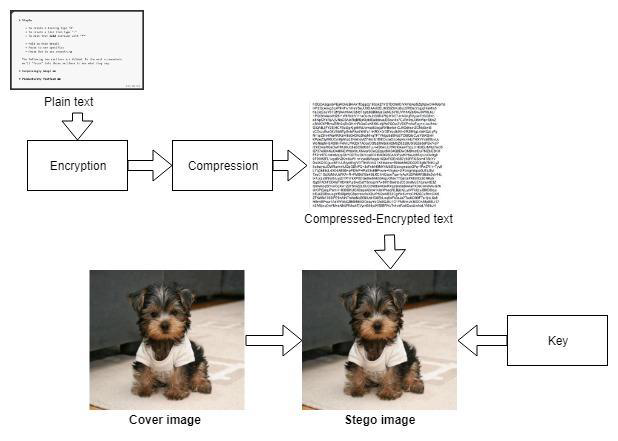

### 2. Phía Người Nhận / Quy Trình Trích Xuất Dữ Liệu (Extraction Process)

Người nhận tiến hành các bước đảo ngược để lấy lại thông điệp:

1. Tải bức ảnh Stego chứa thông tin mật vào ứng dụng.
2. Đọc 32 bit LSB đầu tiên để xác định chiều dài của dữ liệu được giấu.
3. Trích xuất chính xác số lượng bit tương ứng theo chiều dài đã xác định.
4. Tái tạo lại chuỗi mã hóa nén từ các byte trích xuất được.
5. Giải nén chuỗi dữ liệu thông qua thuật toán giải nén **LZW**.
6. Sử dụng khóa bí mật (**Secret Key**) để giải mã **AES**.
7. Hiển thị lại toàn bộ văn bản gốc ban đầu một cách hoàn hảo.

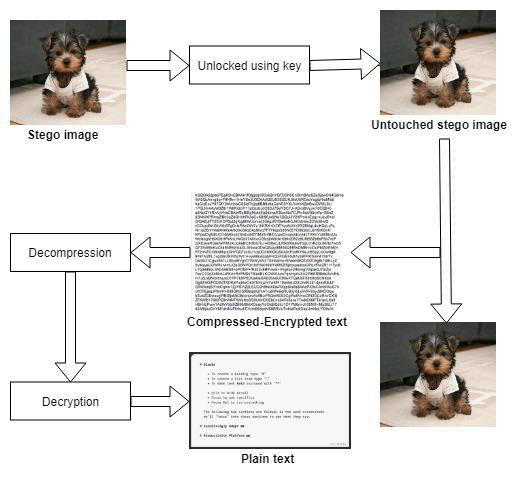

---

## Tại Sao Nên Kết Hợp Mã Hóa, Nén Và Giấu Tin?

Ba kỹ thuật này bổ trợ cho nhau nhằm giải quyết các khía cạnh an toàn thông tin khác nhau:

### Mã Hóa (Encryption)
AES bảo vệ **nội dung** của thông điệp. Ngay cả khi đối phương lấy được dữ liệu thô, họ không thể đọc được nội dung nếu không có khóa bí mật.

```text
Văn bản rõ (Plaintext) ──(AES)──> Dữ liệu mã hóa (Ciphertext)
```

### Nén Dữ Liệu (Compression)
LZW giảm thiểu **kích thước** dữ liệu cần nhúng. Dung lượng dữ liệu càng nhỏ, số lượng pixel bị thay đổi trên ảnh càng ít, giúp bảo toàn tính vô hình và tối ưu hiệu năng.

```text
Dữ liệu mã hóa ──(LZW)──> Dữ liệu đã nén
```

### Kỹ Thuật Giấu Tin (Steganography)
LSB steganography nhằm mục đích **che giấu sự tồn tại** của thông điệp bí mật. Đối phương khi nhìn vào bức ảnh chỉ thấy một tệp hình ảnh bình thường và không hề hay biết có dữ liệu đang được ẩn giấu bên trong.

```text
Dữ liệu đã nén ──(Nhúng LSB)──> Ảnh Stego (Mắt thường không phát hiện)
```

Sự kết hợp này tạo nên cơ chế bảo vệ "kép": Kẻ tấn công vừa không biết sự tồn tại của tin nhắn (nhờ Steganography), vừa không thể giải mã nội dung nếu vô tình phát hiện ra (nhờ AES).

---

## Lưu Ý Về An Toàn & Bảo Mật

- **Mã hóa:** Phiên bản hiện tại sử dụng chế độ AES-ECB để tương thích và minh họa phương pháp lai. Trong các môi trường thực tế chuyên dụng, nên sử dụng các chế độ mã hóa xác thực như **AES-GCM** hoặc **AES-CBC kết hợp HMAC**.
- **Quản lý khóa:** Khóa giải mã cần được lưu trữ và truyền qua các kênh bảo mật được xác thực (ví dụ như TLS/HTTPS hoặc tin nhắn mã hóa đầu cuối).
- **Định dạng ảnh:** Luôn lưu ảnh stego dưới định dạng **PNG** hoặc **BMP** (lossless). Tuyệt đối không dùng định dạng nén suy hao như JPEG vì thuật toán nén DCT của JPEG sẽ làm biến đổi các bit LSB, dẫn đến mất mát hoặc hỏng toàn bộ dữ liệu giấu.

---

## Ngăn Xếp Công Nghệ (Tech Stack)

| Thành Phần | Công Nghệ / Thư Viện | Mô Tả |
|---|---|---|
| **Ngôn ngữ** | Python 3.8+ | Ngôn ngữ phát triển cốt lõi |
| **Giao diện (UI)** | Tkinter | Thư viện đồ họa chuẩn của Python |
| **Mật mã hóa** | `pycryptodome` | Triển khai thuật toán mã hóa khối AES |
| **Nén dữ liệu** | Thuật toán LZW | Thuật toán nén/giải nén LZW không tổn hao dữ liệu |
| **Xử lý ảnh** | `Pillow` (PIL) | Đọc, phân tách kênh màu và ghi ảnh định dạng PNG |
| **Tính toán điểm ảnh** | `NumPy` | Xử lý mảng điểm ảnh và thao tác bit LSB tốc độ cao |
| **Email SMTP** | `smtplib` & `email` | Gửi khóa giải mã bí mật qua email an toàn |

---

## Ảnh Chụp Màn Hình Minh Họa

### Đăng Ký Người Dùng
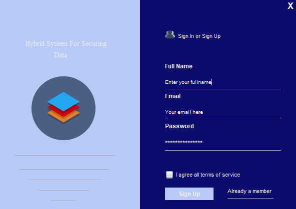

### Đăng Nhập
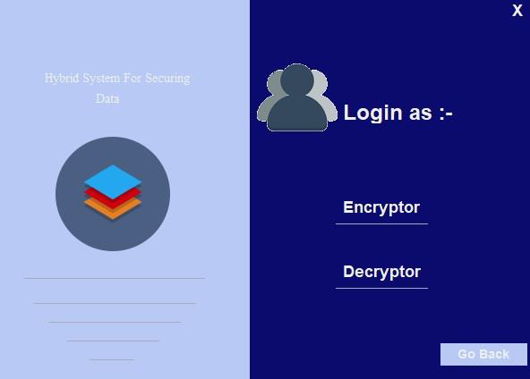

### Bảng Điều Khiển Mã Hóa (Encryptor Dashboard)
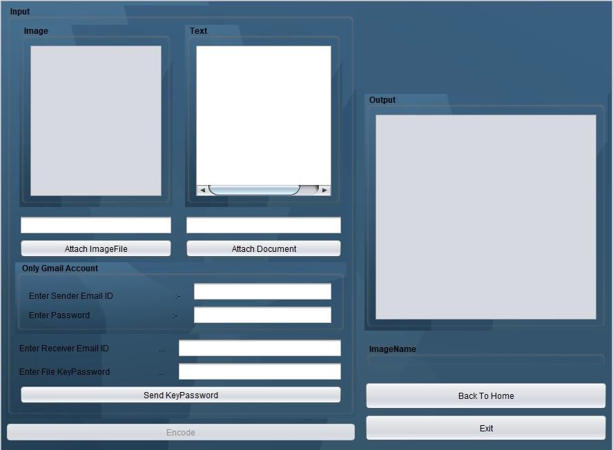

### Quá Trình Nhúng Dữ Liệu
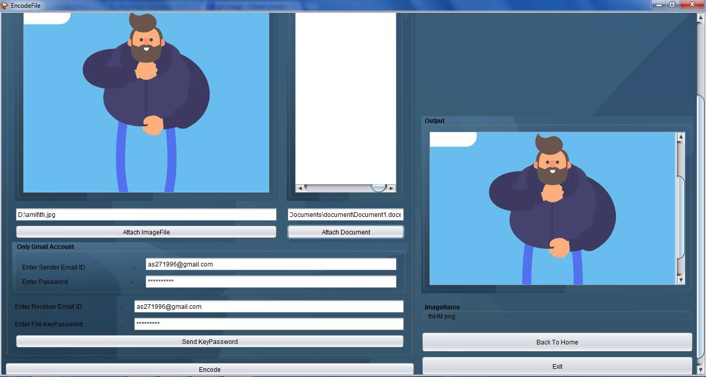

### Nén Dữ Liệu Bằng LZW
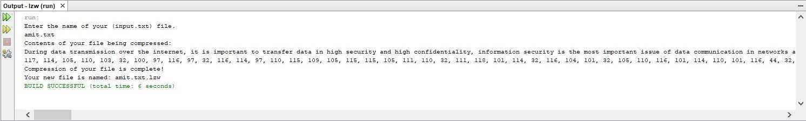

### Kết Quả Nén / Giải Nén
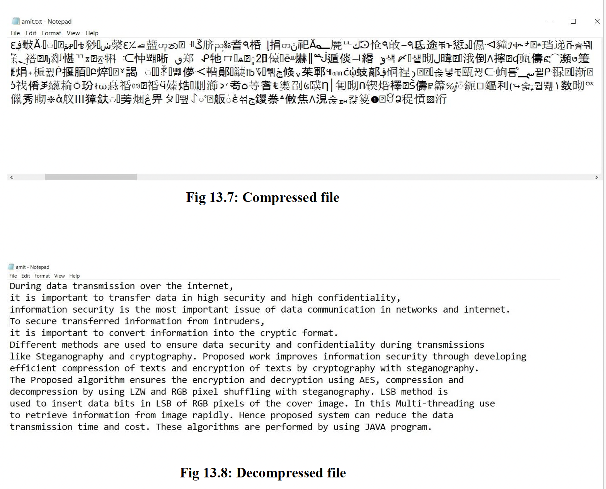

### Bảng Điều Khiển Giải Mã (Decryptor Dashboard)
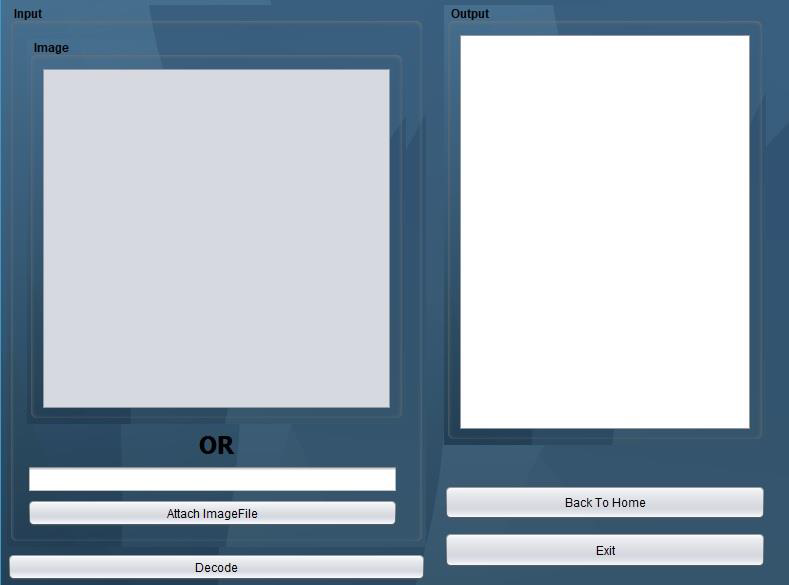

### Trích Xuất Dữ Liệu Giấu
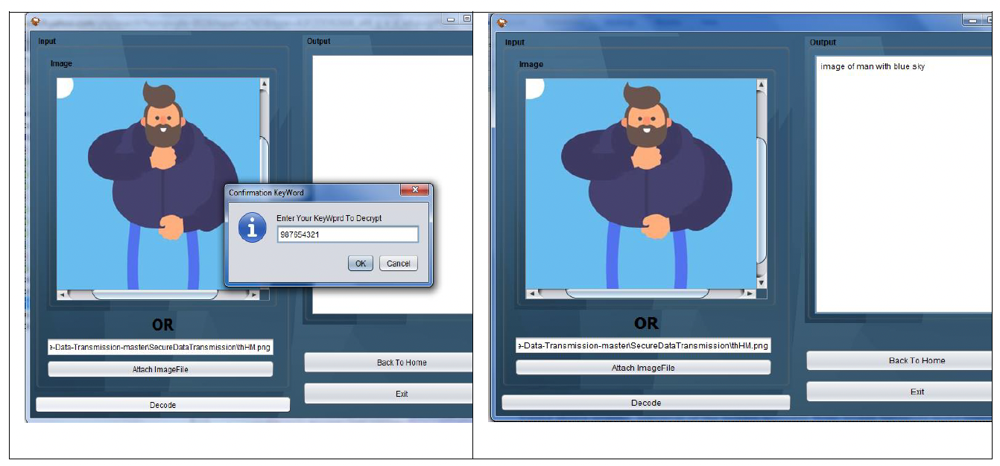

---

## Cấu Trúc Thư Mục Dự Án

```text
python_app/
├── core/
│   ├── __init__.py
│   ├── compression.py       # Triển khai thuật toán nén và giải nén LZW
│   ├── crypto.py            # Mã hóa và giải mã AES (AES-ECB bằng pycryptodome)
│   ├── email_utils.py       # Tiện ích gửi Secret Key qua giao thức Gmail SMTP
│   ├── network.py           # Tiện ích hỗ trợ giao tiếp qua socket/mạng (mở rộng)
│   └── steganography.py     # Nhúng và trích xuất LSB bằng Pillow và NumPy
├── screenshots/             # Ảnh chụp màn hình và sơ đồ quy trình
│   ├── 01-registration.png
│   ├── 02-login.png
│   ├── ...
│   └── 11-extraction-flow.png
├── assets/                  # Thư mục tài nguyên ảnh, biểu tượng
├── ui/                      # Thư mục cấu thành giao diện mở rộng
├── main.py                  # Điểm khởi chạy chương trình (Giao diện Tkinter)
├── requirements.txt         # Danh sách thư viện phụ thuộc (pillow, numpy, pycryptodome)
└── README.md                # Tài liệu hướng dẫn sử dụng tiếng Việt
```

---

## Chi Tiết Các Module Chính

### 1. `core/crypto.py` (Mã Hóa AES)
Cung cấp lớp `AESCrypt` thực hiện mã hóa và giải mã văn bản bằng thuật toán AES. Dữ liệu được đệm (padded) theo chuẩn PKCS7 và chuỗi sau mã hóa được mã hóa Base64 để thuận tiện lưu trữ và truyền tải.

### 2. `core/compression.py` (Nén Dữ Liệu LZW)
Triển khai thuật toán nén Lempel-Ziv-Welch (LZW) không mất dữ liệu:
- Xây dựng từ điển động chứa 256 ký tự ASCII ban đầu và mở rộng dần theo các mẫu lặp lại trong chuỗi.
- Giúp tối ưu hóa dung lượng ciphertext trước khi đưa vào bước giấu tin.

### 3. `core/steganography.py` (Giấu Tin LSB)
Quản lý việc đọc, nhúng và giải mã dữ liệu trên các điểm ảnh:
- **Header 32-bit**: 4 byte đầu tiên của ảnh dùng để ghi chính xác độ dài byte của dữ liệu.
- **Tăng tốc với NumPy**: Chuyển ma trận pixel thành mảng một chiều phẳng và sử dụng toán tử bit trên mảng NumPy để ghi đè LSB (`(pixel & ~1) | bit`) với tốc độ vượt trội.
- Tự động kiểm tra dung lượng ảnh để đảm bảo ảnh đủ số lượng pixel cần thiết trước khi nhúng.

### 4. `core/email_utils.py` (Chia Sẻ Khóa Qua Email)
Hỗ trợ gửi email chứa khóa giải mã qua cổng SMTP bảo mật (cổng 587 với STARTTLS) của Gmail đến người nhận được chỉ định.

### 5. `main.py` (Giao Diện Người Dùng Tkinter)
Giao diện trực quan chia thành các cửa sổ:
- **Màn hình chính**: Chọn tác vụ Giấu tin (Encode), Trích xuất (Decode), Trợ giúp (About) hoặc Thoát.
- **Cửa sổ Encode**: Chọn ảnh gốc, nhập khóa bí mật, nhập thông điệp, tùy chọn nhập thông tin gửi Email và lưu ảnh PNG kết quả.
- **Cửa sổ Decode**: Chọn ảnh Stego cần đọc và nhấn trích xuất để hiển thị văn bản đã giấu.

---

## Hướng Dẫn Cài Đặt Và Sử Dụng

### Yêu Cầu Môi Trường
- Đã cài đặt **Python 3.8** trở lên.
- Đã cấu hình biến môi trường `python` và `pip`.

---

### Bước 1: Mở Thư Mục Ứng Dụng
Mở terminal (PowerShell, Command Prompt hoặc Bash) và điều hướng tới thư mục `python_app`:

```bash
cd "C:\Users\Lenovo\Desktop\Image Steganography\python_app"
```

---

### Bước 2: Cài Đặt Các Thư Viện Phụ Thuộc
Chạy lệnh cài đặt các gói cần thiết thông qua tệp `requirements.txt`:

```bash
pip install -r requirements.txt
```

*(Các thư viện chính gồm: `pillow`, `numpy`, `pycryptodome`)*

---

### Bước 3: Khởi Chạy Ứng Dụng
Chạy lệnh sau để khởi động giao diện ứng dụng:

```bash
python main.py
```

---

### Hướng Dẫn Thao Tác Trên Giao Diện

#### 1. Mã Hóa & Giấu Tin (Encode Text into Image)
1. Trên màn hình chính, nhấn vào nút **"Encode Text into Image"**.
2. **Bước 1 (Select Image):** Nhấn **Browse Image** để chọn một bức ảnh (hỗ trợ PNG, JPG, BMP).
3. **Bước 2 (Enter Secret Key):** Nhập khóa AES bạn muốn dùng (hoặc dùng khóa mặc định 16 ký tự).
4. **Bước 3 (Enter Message):** Nhập thông điệp văn bản bí mật cần gửi.
5. **Bước 4 (Optional Email):** *(Tùy chọn)* Nhập tài khoản Gmail, Mật khẩu ứng dụng (App Password) và email người nhận nếu muốn gửi khóa tự động.
6. Nhấn nút **"ENCODE & SAVE"** và chọn nơi lưu tệp ảnh PNG mới.

#### 2. Trích Xuất & Giải Mã (Decode from Image)
1. Trên màn hình chính, nhấn vào nút **"Decode from Image"**.
2. Nhấn **Browse Image** và chọn bức ảnh PNG chứa dữ liệu ẩn (Stego Image).
3. Nhấn nút **"EXTRACT & DECODE"**.
4. Ứng dụng sẽ tự động trích xuất chuỗi bit LSB, giải nén LZW, giải mã AES và hiển thị thông điệp gốc vào ô kết quả.

---

## Đánh Giá Chất Lượng Ảnh (Image Quality Evaluation)

Trong kỹ thuật giấu tin LSB trên ảnh số, hai đại lượng thường được dùng để đánh giá mức độ biến đổi của ảnh:

- **MSE (Mean Squared Error - Sai số bình phương trung bình)**: Đo lường độ sai lệch trung bình giữa các giá trị điểm ảnh của ảnh gốc và ảnh sau khi giấu tin. Giá trị MSE càng nhỏ, ảnh stego càng giống ảnh gốc.
- **PSNR (Peak Signal-to-Noise Ratio - Tỷ số tín hiệu trên nhiễu cực đại)**: Đo lường chất lượng ảnh tính theo decibel (dB). Giá trị PSNR càng cao (thông thường trên 30 - 40 dB), mắt thường của con người hoàn toàn không thể nhận ra bất kỳ sự khác biệt nào giữa hai ảnh.

Do ứng dụng chỉ thay đổi duy nhất 1 bit cuối (LSB) của mỗi thành phần màu và xuất ra tệp PNG lossless, độ sai lệch cực kỳ nhỏ, đảm bảo mức độ bí mật cao cho dữ liệu.

---

## Hướng Phát Triển Tương Lai

- [ ] **Mã hóa hiện đại hơn:** Bổ sung hỗ trợ mã hóa xác thực AES-GCM kèm vector khởi tạo ngẫu nhiên (IV) cho mỗi lần mã hóa.
- [ ] **Giấu tệp tin đa phương tiện:** Hỗ trợ giấu cả tệp tin nhị phân bất kỳ (PDF, DOCX, ZIP, v.v.) thay vì chỉ chuỗi văn bản.
- [ ] **Tùy biến vị trí nhúng ngẫu nhiên:** Sử dụng khóa bí mật làm hạt giống sinh chuỗi giả ngẫu nhiên (PRNG) để chọn các pixel nhúng thay vì nhúng tuần tự từ đầu mảng.
- [ ] **Tính toán trực tiếp PSNR & MSE:** Tự động tính và hiển thị thông số PSNR/MSE trên giao diện ngay sau khi tạo ảnh Stego.
- [ ] **Giao thức mạng trực tiếp:** Kích hoạt tính năng truyền tải tệp và chat mã hóa trực tiếp giữa hai máy khách thông qua giao thức TCP Socket.

